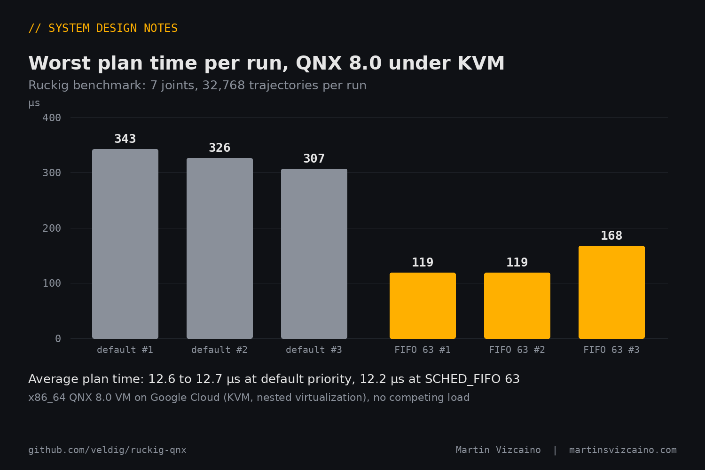

# ruckig-qnx: Ruckig motion generation on QNX 8.0

[Ruckig](https://github.com/pantor/ruckig) is a widely used open-source library for real-time, jerk-limited trajectory generation for robots and machines (MIT license). This repository ports it to **QNX SDP 8.0**: two small build fixes, CMake toolchain files for QNX x86_64 and aarch64le, scripts that build it with the QNX toolchain and run its full test suite on a QNX 8.0 target, and the measured results.

Upstream pull request with the fix: [pantor/ruckig#274](https://github.com/pantor/ruckig/pull/274)

Built for the QNX Global Hackathon 2026 (Open-Source Contribution & Ports).

Demo video (1:48): https://youtu.be/jr_Fj3NRpuk



## Why

Ruckig computes time-optimal, jerk-limited motions in microseconds, so a robot can replan on every control cycle. QNX is a real-time OS used in robots, medical devices and cars. Out of the box, Ruckig's library compiled on QNX but its test suite and its cloud client did not, so nobody could verify it there.

## What was broken, and the fix

Tested against upstream commit [`14c9814`](https://github.com/pantor/ruckig/commit/14c9814ff00e683daa3877028b422411d2264653) (Nov 24, 2026).

| Problem on QNX 8.0 | Cause | Fix (QNX-only, in `CMakeLists.txt`) |
|---|---|---|
| Test suite does not compile: `reference to 'ostream' is ambiguous`, errors in `<variant>` | QNX SDP 8.0 pairs **GCC with LLVM libc++**. doctest only checks for libc++ (`_LIBCPP_VERSION`) under Clang, so under GCC it forward-declares `std::ostream` and `std::tuple`, which clash with libc++'s inline namespace `std::__2`. doctest 2.5.0 (latest) still does this. | Define `DOCTEST_CONFIG_USE_STD_HEADERS` for the test targets on QNX |
| Cloud client (`BUILD_CLOUD_CLIENT=ON`, the default) fails to link: undefined `socket`, `connect`, `getaddrinfo`, ... | On QNX the BSD socket API lives in **libsocket**, not libc | Link `socket` privately to `ruckig` on QNX |

The whole change is 9 added lines: [`patches/0001-Fix-build-and-tests-on-QNX-8.0.patch`](patches/0001-Fix-build-and-tests-on-QNX-8.0.patch). Both blocks are guarded by `if(CMAKE_SYSTEM_NAME STREQUAL "QNX")`, so other platforms are unaffected. (CMake 3.22 does not set the `QNX` variable, so the guard checks `CMAKE_SYSTEM_NAME`.)

## Results on QNX 8.0

### Before and after (x86_64)

| | Upstream | With the patch |
|---|---|---|
| `libruckig.so` | builds | builds |
| `test-target` (doctest suite) | does not compile | **14/14 test cases, 1,441,963/1,441,963 assertions pass** |
| Cloud client build | link fails | builds |
| aarch64le build (cloud client on) | not tested | builds with 0 errors (compile only, not run on an ARM target) |
| Full default build (`cmake --build`) | fails | succeeds; all 9 examples build and `example-01_position` runs on target |

The test suite checks 262,144 randomly generated trajectories (position, velocity, discrete, second-order and high-limit cases) against Ruckig's own validity checks.

### Timing

Ruckig's own `benchmark-target`: 7 degrees of freedom, 32,768 random trajectories per run, release build, 3 runs at each priority. QNX 8.0 x86_64 under **KVM** on a Google Cloud n2-standard-4 VM with nested virtualization (2 vCPUs for QNX), no other load. Raw output in `results/kvm/`.

| Per-trajectory calculation time | Default priority (3 runs) | SCHED_FIFO 63 via `on -p 63f` (3 runs) |
|---|---|---|
| Average | 12.6 to 12.7 µs | 12.2 µs |
| Worst case in a run | 307 to 343 µs | 119 to 167 µs |
| End-to-end average | 14.5 to 14.6 µs | 14.0 µs |

The average barely moves with priority, but the worst case drops to roughly half at real-time priority. For a controller that replans every cycle, the worst case is the number that matters: at SCHED_FIFO 63 the worst plan in about 98,000 took under 0.17 ms, well inside a 1 ms control cycle. These are VM numbers, not bare metal, and the benchmark ran with no competing load.

Under QEMU emulation on a Mac the same benchmark averaged 216 to 296 µs with worst cases of tens of milliseconds (logs in `results/`), so use the KVM numbers.

## Repository layout

```
patches/0001-Fix-build-and-tests-on-QNX-8.0.patch   the fix (git format-patch, applies to upstream 14c9814)
cmake/qnx-x86_64.cmake, cmake/qnx-aarch64le.cmake   CMake toolchain files for QNX SDP 8.0 (qcc / q++)
scripts/fetch_ruckig.sh                             clone upstream at the tested commit and apply the patch
scripts/build_in_container.sh                       cross-compile: x86_64 (cloud on/off), aarch64le
run_ruckig_test.sh                                  Mac one-shot: build, boot QNX VM, run tests/benchmark/example
run_cloud_kvm_ruckig.sh, scripts/remote_kvm_ruckig.sh   same on QNX under KVM on a temporary cloud VM
results/                                            logs from the runs above
```

## Build and run

Requirements: QNX SDP 8.0 with the QNX Everywhere (non-commercial) license, installed to `~/qnx800` with the Linux 64-bit host tools; CMake 3.15 or newer.

On an x86_64 Linux host:

```bash
bash scripts/fetch_ruckig.sh
source ~/qnx800/qnxsdp-env.sh
cmake -S ruckig -B build -DCMAKE_TOOLCHAIN_FILE=$PWD/cmake/qnx-x86_64.cmake \
      -DCMAKE_BUILD_TYPE=Release -DBUILD_TESTS=ON -DBUILD_EXAMPLES=ON -DBUILD_BENCHMARK=ON
cmake --build build -j
# copy build/libruckig.so* and build/test-target to the QNX target, then on the target:
LD_LIBRARY_PATH=. ./test-target
```

On an Apple Silicon Mac the QNX host tools run in an x86_64 Docker container and the target runs in QEMU; `run_ruckig_test.sh` does all of it in one command. It uses the QNX 8.0 image and container from my [qnx-vibguard](https://github.com/veldig/qnx-vibguard) project (`go.sh` there sets them up).

## Where QNX is used

- `patches/0001-...patch`: QNX-specific build fixes (libsocket, GCC with libc++).
- `cmake/qnx-*.cmake`: QNX SDP 8.0 cross toolchain (`qcc` / `q++`, `gcc_ntox86_64`, `gcc_ntoaarch64le`).
- `run_ruckig_test.sh`: runs on a QNX 8.0 target built with `mkqnximage`; benchmark also run under `on -p 63f` (SCHED_FIFO 63).

## License

The patch is offered upstream under Ruckig's MIT license. Scripts and docs in this repository: MIT.

Martin Vizcaino · [martinsvizcaino.com](https://martinsvizcaino.com) · [LinkedIn](https://www.linkedin.com/in/martinvizcaino/)
